# Inventory and Data Management System

**Name:** Ojaswi Pandey
**Roll No:** 2501060183
**Course:** BCA (AI & DS) | **Subject:** Backend Development
**Semester:** 3rd | **Section:** D
**GitHub:** [ojaswiandcode/inventory-system](https://github.com/ojaswiandcode/inventory-system)

A RESTful backend for managing a store or warehouse product catalogue, built with **Node.js, Express.js, MongoDB (Mongoose) and dotenv**. It supports product CRUD, filtering/sorting/pagination, safe stock adjustment, and inventory reports built with aggregation pipelines.

---

## Features
- Mongoose schema with field-level validation (required, min/max, enum, regex, unique, whole-number checks)
- Complete CRUD operations for products
- Filtering, sorting and pagination through query strings
- Atomic stock adjustment (restock and sale); stock can never go below zero
- Aggregation reports: low-stock alert and category-wise inventory summary
- Centralized error handling and input-validation middleware
- Environment variables managed with dotenv

## Tech Stack
Node.js, Express.js, MongoDB Atlas, Mongoose, dotenv

## Project Structure
```
inventory-system/
├── config/db.js                   # MongoDB connection
├── controllers/productController.js
├── middleware/
│   ├── errorHandler.js            # 404 + centralized error handler
│   └── validate.js                # id / body / stock-change validation
├── models/Product.js              # Mongoose schema
├── routes/productRoutes.js
├── utils/                         # AppError.js, asyncHandler.js
├── screenshots/                   # Postman outputs
├── seed.js                        # loads 12 sample products
├── server.js
├── .env.example
└── package.json
```

## Setup and Run
```bash
git clone https://github.com/ojaswiandcode/inventory-system.git
cd inventory-system
npm install
```
Create a `.env` file in the project root (see `.env.example`):
```
PORT=5000
MONGO_URI=mongodb+srv://<username>:<password>@<cluster-host>/inventory_db
NODE_ENV=development
```
Then:
```bash
npm run seed     # optional: loads 12 sample products
npm start        # starts the server at http://localhost:5000
```

## Product Schema
| Field | Type | Rules |
|---|---|---|
| name | String | required, trimmed, 2-100 characters |
| sku | String | required, unique, uppercase, letters/numbers/hyphens only |
| category | String | required, one of Electronics, Apparel, Furniture, Stationery, Groceries, Books, Sports, Home & Kitchen, Toys, Other |
| price | Number | required, >= 0 |
| quantity | Number | required, whole number, >= 0 |
| reorderLevel | Number | whole number, >= 0, default 10 |
| supplier | String | optional, default "Unknown" |
| stockValue | Virtual | price x quantity |
| createdAt / updatedAt | Date | automatic timestamps |

## API Endpoints
| Method | Endpoint | Description |
|---|---|---|
| POST | `/api/products` | Create a product |
| GET | `/api/products` | List products (filter, sort, paginate) |
| GET | `/api/products/:id` | Get a single product |
| PUT | `/api/products/:id` | Update product details |
| PATCH | `/api/products/:id/stock` | Adjust stock (`{"change": 10}` restock, `{"change": -3}` sale) |
| DELETE | `/api/products/:id` | Delete a product |
| GET | `/api/products/low-stock` | Products where quantity <= reorderLevel (aggregation) |
| GET | `/api/products/summary` | Category-wise inventory summary (aggregation) |

### Query parameters for `GET /api/products`
| Param | Example | Meaning |
|---|---|---|
| category | `?category=Furniture` | exact category (case-insensitive) |
| supplier | `?supplier=ikea` | partial match |
| search | `?search=table` | name or SKU contains the text |
| minPrice / maxPrice | `?minPrice=500&maxPrice=5000` | price range |
| inStock | `?inStock=true` | only items with quantity > 0 |
| sort | `?sort=-price,name` | `-` means descending |
| page / limit | `?page=2&limit=5` | pagination (default 1 / 10, max limit 100) |

Example: `GET /api/products?category=Electronics&sort=-price&page=1&limit=2`

### Error response format
```json
{
  "success": false,
  "message": "Validation failed",
  "errors": [{ "field": "price", "message": "Price cannot be negative" }]
}
```
Status codes used: 200, 201, 400 (validation / invalid id / insufficient stock), 404, 409 (duplicate SKU), 500.

---

## Postman Output Screenshots

### 1. GET /api/products (filter, sort, pagination) and GET /api/products/:id
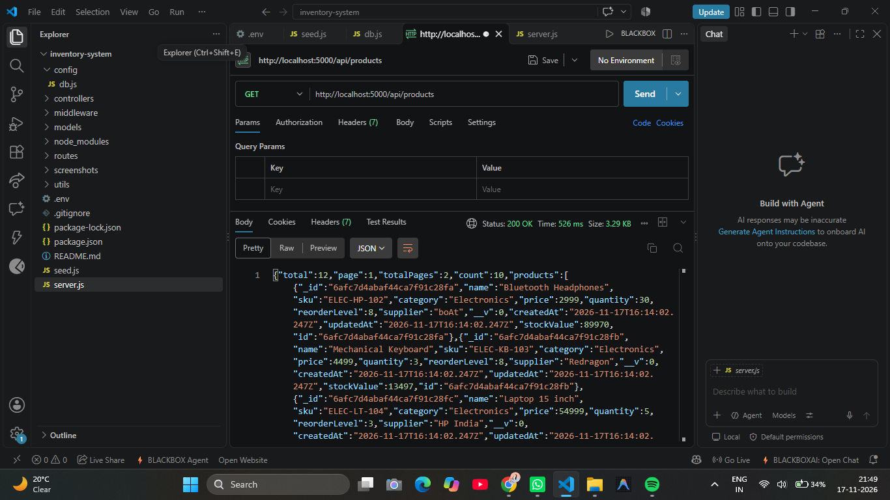
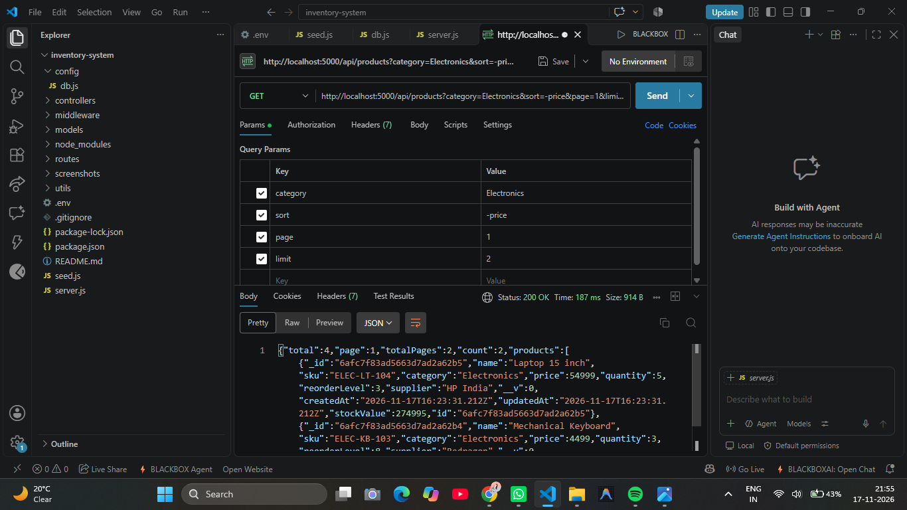
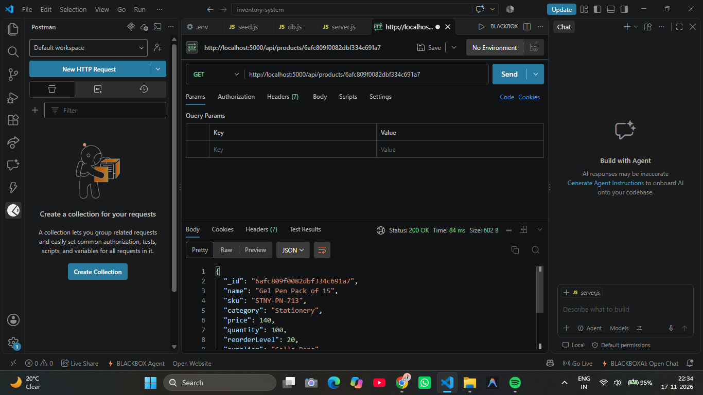

### 2. POST /api/products (create)
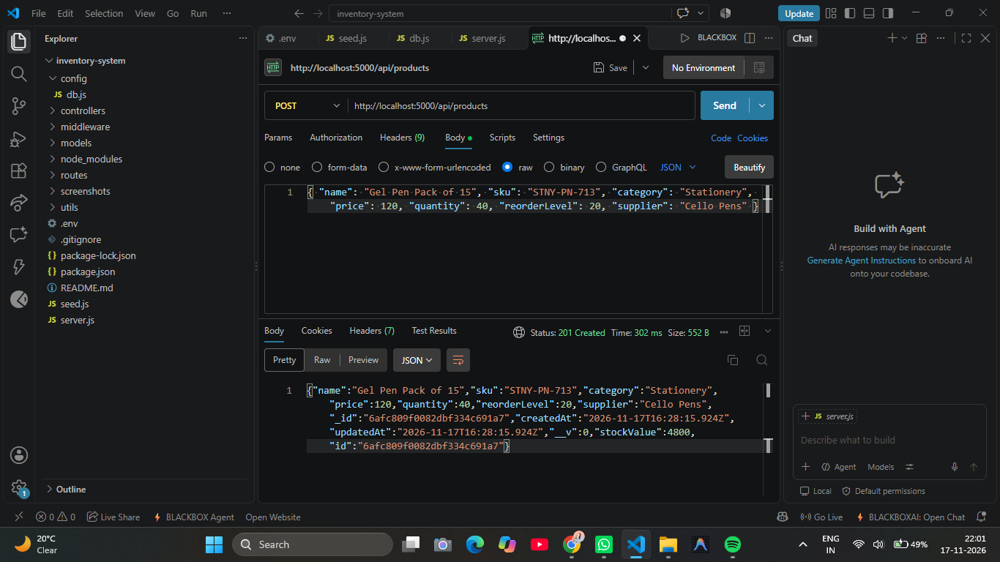

### 3. PUT /api/products/:id (update)
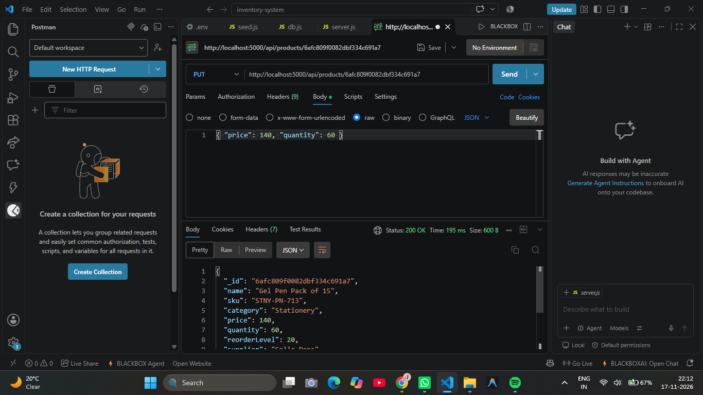

### 4. PATCH /api/products/:id/stock (restock / sale)
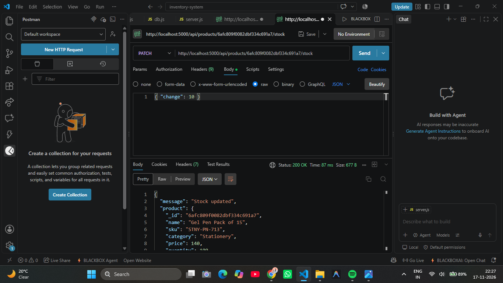

### 5. GET /api/products/low-stock
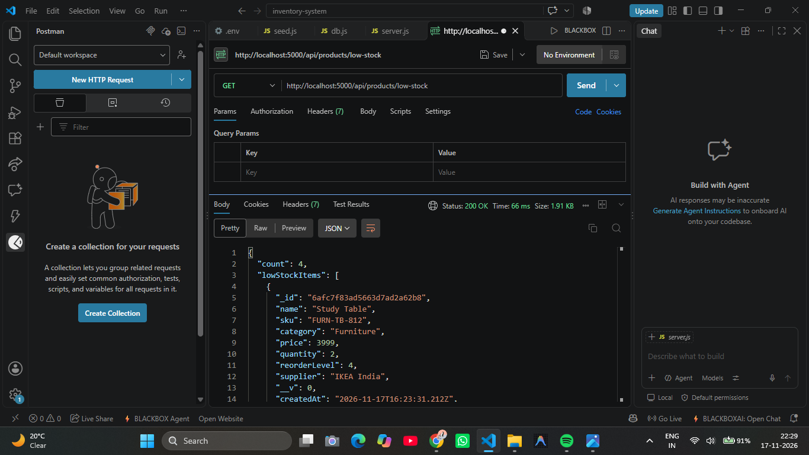

### 6. GET /api/products/summary
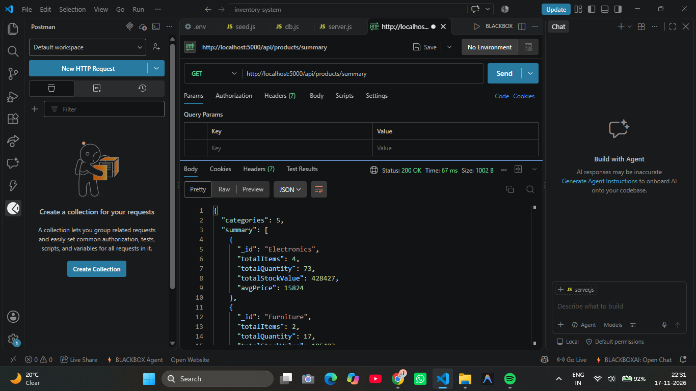

### 7. DELETE /api/products/:id
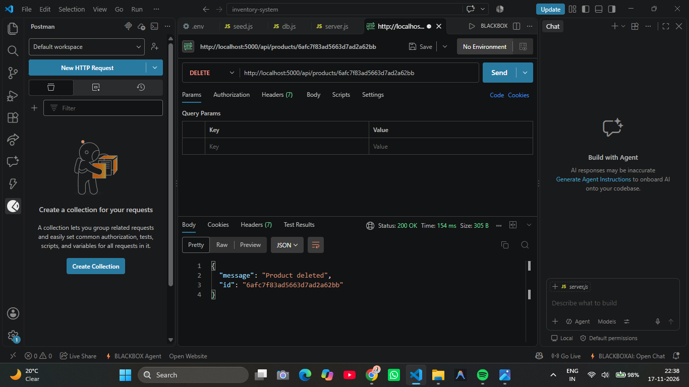

### 8. Validation / error handling
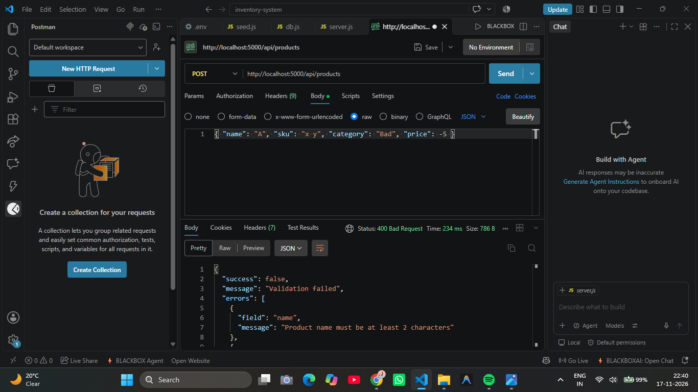
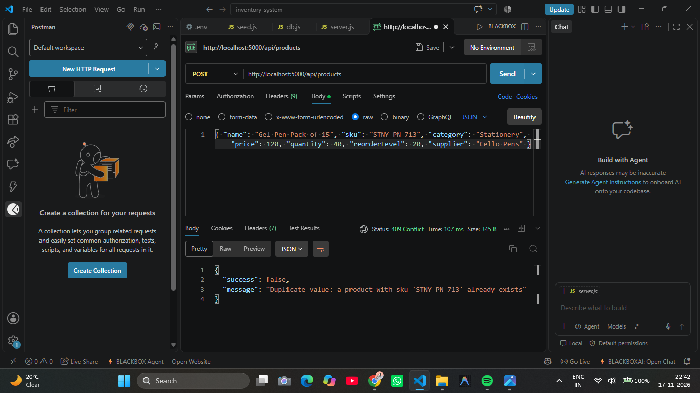
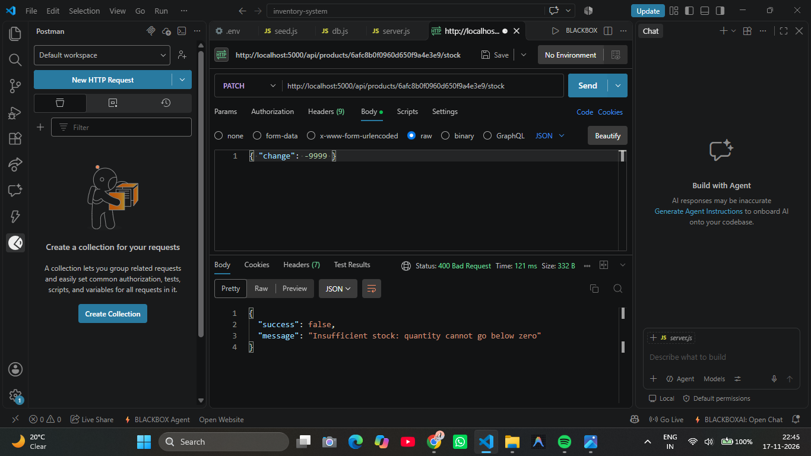
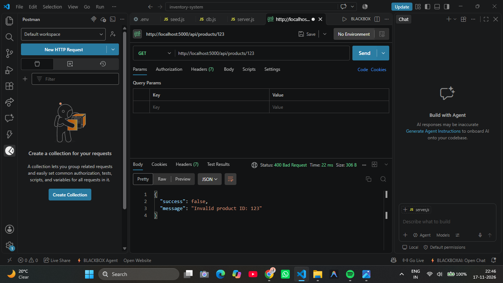

---

## Author
**Ojaswi Pandey** | BCA (AI & DS), 3rd Semester, Section D | Roll No. 2501060183